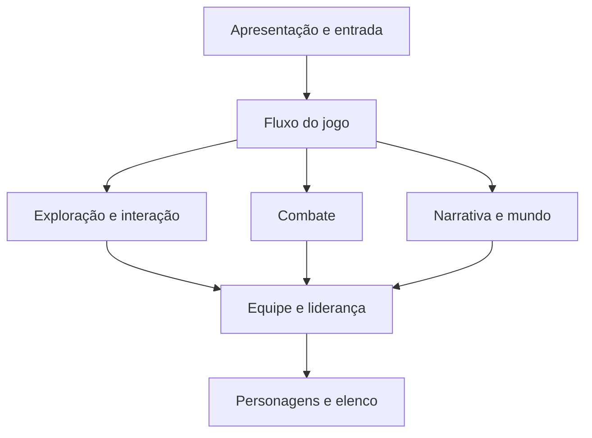

# Proposta de arquitetura do RPG

> Documento histórico anterior ao GDD consolidado. Pendências e fluxos deste texto não substituem as decisões atuais em [GDD.md](GDD.md) e [DECISOES.md](DECISOES.md). A arquitetura implementada do laboratório está em [ARQUITETURA_LAB.md](ARQUITETURA_LAB.md).

**Status: proposta para discussão; nenhuma escolha técnica deste documento foi aprovada.**

Esta organização parte de [RPG_contexto_para_Codex.md](../RPG_contexto_para_Codex.md). Os requisitos confirmados continuam valendo; as divisões de sistemas e os fluxos abaixo são sugestões de como sustentá-los. Não há escolha implícita de engine, linguagem, dimensão gráfica, plataforma ou técnica de implementação.

## 1. Direção proposta

Organizar o jogo em sistemas com responsabilidades claras, dentro de um único projeto. Separar conceitualmente regras do jogo, conteúdo e apresentação, aproveitando os recursos da engine que vier a ser escolhida.

A proposta busca permitir mudanças em combate, movimentação ou interface sem reescrever as regras de composição da equipe. Não exige criar uma biblioteca independente da engine, um framework próprio ou uma infraestrutura de eventos.

## 2. Sistemas e responsabilidades

| Sistema proposto | Responsabilidade | Limite importante |
| --- | --- | --- |
| Personagens e elenco | Identificar protagonista e companheiros fixos; manter quem foi recrutado e o estado individual relevante. | Não introduzir criação livre de personagem nem fixar raças, classes, atributos ou progressão ainda pendentes. |
| Equipe e liderança | Manter integrantes ativos, reservas e líder; validar alterações na composição. | No máximo quatro ativos; troca com reservas somente no local especial; liderança determina quem pode usar habilidades especiais de exploração. |
| Exploração e interação | Coordenar movimento no mapa, fila, interação com obstáculos e consulta às condições de acesso. | A técnica de seguimento permanece aberta; não permitir que reservas ou seguidores usem habilidades especiais de exploração. |
| Combate | Coordenar batalhas por turnos usando os integrantes ativos. | Ordem dos turnos, ritmo, ações, técnicas combinadas e progressão permanecem abertos. |
| Narrativa e mundo | Representar eventos da história, recrutamentos, objetivos dos personagens e mudanças no mundo. | A arquitetura não define enredo, elenco final ou justificativa do local especial. |
| Fluxo do jogo | Coordenar entrada e saída de exploração, batalha e reunião, quando esses fluxos forem definidos. | Não confundir troca de líder com troca de integrantes ativos por reservas. |
| Apresentação e entrada | Mostrar mapas, personagens, interfaces e animações; converter comandos do jogador em solicitações aos sistemas. | Um botão ou menu não deve autorizar uma ação que as regras proíbem. |
| Persistência, se adotada | Salvar e restaurar o estado necessário à continuidade da partida. | Existência, formato, pontos e frequência de salvamento precisam de definição; este item é apenas uma responsabilidade prevista. |

Essas divisões são lógicas. Não representam ainda pastas, classes, cenas, serviços ou arquivos obrigatórios.

## 3. Relações entre os sistemas

As setas indicam consultas ou solicitações, não uma tecnologia de comunicação. A apresentação pode ler o estado necessário para exibir o jogo; o desenho destaca principalmente onde ficam as regras.

Equipe e liderança seriam a autoridade única sobre a composição do grupo. Exploração e combate consultariam esse sistema, evitando versões independentes de quem está ativo. A narrativa solicitaria recrutamentos e mudanças previstas pelas regras, sem alterar silenciosamente a equipe.

O local especial seria um contexto que permite trocar ativos e reservas. Sua identidade visual e narrativa não precisa ser decidida para estabelecer essa responsabilidade. Não estamos propondo uma classe ou subsistema exclusivo para o local neste momento.

## 4. Conceitos de dados

Proposta de separar definições de conteúdo do estado que muda durante a partida:

| Conceito | Definição de conteúdo | Estado da partida |
| --- | --- | --- |
| Personagem | Identidade fixa do companheiro e referências ao seu conteúdo. | Recrutamento e demais estados que forem definidos; nome e gênero escolhidos para o protagonista. |
| Equipe | Regras de composição. | Integrantes ativos e líder atual; reservas derivadas do elenco disponível, conforme as regras futuras. |
| Habilidade de exploração | Identidade da habilidade e tipos de interação que permite. | Condições adicionais, somente se forem aprovadas. |
| Obstáculo | Requisitos para uma interação ou passagem. | Alterações persistentes no obstáculo, somente se esse comportamento for definido. |
| Evento narrativo | Condições e consequências planejadas. | Eventos ocorridos e outros marcadores necessários à história. |

Usar identificadores estáveis para relacionar esses conceitos é uma sugestão técnica. O formato concreto — recursos da engine, arquivos de dados ou outra solução — fica para depois.

Não há nesta proposta uma lista aprovada de atributos, habilidades, classes, raças, itens ou estados de combate. Inventário, equipamentos, economia e missões também não estão sendo acrescentados ao escopo.

## 5. Regras confirmadas que a arquitetura precisa preservar

- A equipe ativa tem no máximo quatro integrantes.
- Apenas integrantes ativos participam das batalhas.
- Durante a exploração, a equipe aparece em fila, com o líder à frente.
- Trocar o líder muda o personagem controlado e o sprite à frente da fila.
- Habilidades especiais de exploração exigem que seu personagem esteja ativo e seja o líder.
- Trocas entre ativos e reservas ocorrem somente no local especial de reunião.
- Deve ser possível trocar o líder entre os integrantes ativos durante a exploração.
- Os companheiros são fixos e recrutados gradualmente pela história.
- O protagonista é humano, com nome e gênero escolhidos pelo jogador, sem criação livre.

O líder pertencer à equipe ativa é uma consequência dessas regras. Já a obrigação de manter o protagonista ativo continua sem resposta. O sistema de equipe deve ser planejado para acomodar essa decisão futura, sem escolher uma resposta por antecipação.

O recrutamento gradual também exige discutir a apresentação da fila quando houver menos de quatro integrantes. Não estamos fixando agora a composição inicial nem regras para uma equipe vazia.

## 6. Fluxos conceituais para avaliar a proposta

### Trocar o líder durante a exploração

1. O jogador solicita a liderança de outro integrante ativo.
2. Equipe e liderança valida o integrante solicitado.
3. Exploração passa a controlar e mostrar o novo líder à frente da fila.
4. Interações especiais passam a considerar as habilidades do novo líder.

Menus, teclas, animação da mudança, ordem dos seguidores e restrições durante interações ficam em aberto.

### Interagir com um obstáculo especial

1. Exploração identifica o obstáculo e seus requisitos.
2. Consulta quem é o líder e se ele possui a habilidade necessária.
3. Se as condições forem atendidas, solicita o efeito definido para aquela interação.
4. Se não forem, apresenta a resposta que vier a ser definida para o jogador.

Um personagem na reserva ou seguindo na fila não satisfaz o requisito de uma habilidade especial por simplesmente possuí-la. Efeitos permanentes, custos de uso e habilidades passivas não estão definidos.

### Trocar um ativo por uma reserva

1. O fluxo do jogo estabelece que o jogador está no local especial.
2. O jogador solicita uma alteração na equipe.
3. Equipe e liderança valida o contexto e o limite de quatro ativos.
4. A alteração é aplicada e a apresentação é atualizada.

A saída do líder e a eventual saída do protagonista precisam de regras próprias antes da implementação. Esse fluxo não presume que ambas serão permitidas.

### Entrar em batalha

O combate recebe a composição ativa e organiza uma batalha por turnos. Reservas não entram como participantes. Isso não decide ordem de turnos, ações disponíveis, movimentação em batalha, troca durante combate ou efeitos sobre a fila após a batalha.

## 7. Exploração sem bloqueios frustrantes

Como trocar ativos por reservas exige retornar ao local especial, o desenho dos mapas deve ser revisado junto com os requisitos de habilidades.

Sugestão de revisão de cada obstáculo essencial: verificar se o companheiro necessário já pode ter sido recrutado, se pode estar na equipe e se o jogador tem uma forma compreensível de preparar a composição exigida. Caminhos opcionais também precisam comunicar oportunidades de retorno.

Ainda precisam ser discutidas as soluções concretas para prevenir bloqueios: acesso ao local especial, avisos, rotas de retorno ou outras alternativas. Nenhuma delas está aprovada neste documento.

## 8. Decisões que podem ser adiadas e decisões necessárias antes de programar

| Decisão aberta | Impacto na arquitetura | Quando resolver |
| --- | --- | --- |
| Plataforma-alvo e forma de jogar | Entrada, interface, distribuição e restrições técnicas. | Antes da escolha técnica e da implementação. |
| Escopo inicial e dimensão gráfica | Produção de conteúdo, mapas, câmera e volume de trabalho. | Antes de implementar o primeiro protótipo. |
| Engine e linguagem | Organização física do projeto e integração dos sistemas. | Antes de criar a estrutura de código. |
| Protagonista obrigatório ou elegível à reserva | Validação de composição e formação de equipes. | Antes de implementar trocas com reservas. |
| Formação e seguimento da fila | Movimento, colisão e apresentação. | Antes de implementar o seguimento. |
| Detalhes do combate | Organização interna do sistema de batalha. | Antes do protótipo de combate. |
| Funcionamento do local especial | Acesso, transições e prevenção de bloqueios. | Antes de implementar o ciclo de troca da equipe. |
| Salvamento | Estado persistido e restauração da partida. | Antes de implementar persistência. |

A escolha de engine deve ser feita depois de entender plataforma e escopo. Este documento não recomenda uma ferramenta específica.

## 9. Sequência sugerida de trabalho

1. Revisar esta divisão de responsabilidades e registrar o que for aprovado.
2. Alinhar plataforma, escopo e apresentação pretendida; então escolher engine e linguagem.
3. Definir a estrutura física do projeto de acordo com essas escolhas.
4. Somente quando houver pedido para prototipar, seguir o recorte indicado no contexto: mapa explorável, quatro sprites em fila, troca de líder e obstáculo que exige habilidade do líder.
5. Planejar depois a validação de recrutamento, reservas e reunião, e detalhar combate conforme o escopo aprovado.

Esta sequência não autoriza implementação nem inclui combate ou troca com reservas automaticamente no primeiro protótipo.
